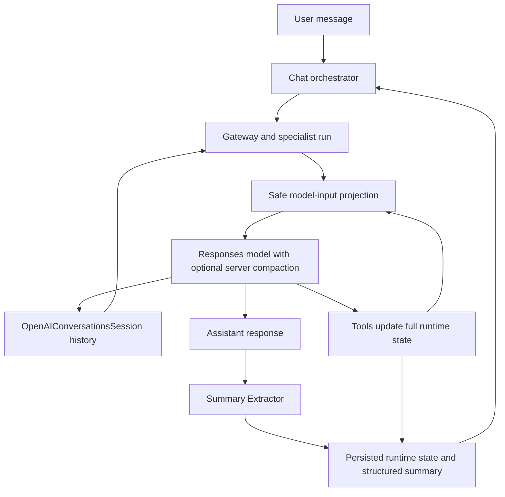

# OpenAI Session Optimization — Implementation Task Plan

Research verified: **2026-09-06**  
Repository: `coa_com_Api`  
Status: **Core implementation and deterministic verification completed 2026-09-08; observation mode is the default. Live rollout gates remain open.**  
Architecture decision: **Keep `OpenAIConversationsSession` and the existing chat storage.**

Implementation evidence and remaining work: [implementation status](./session-optimization-implementation-status.md). Checked tasks indicate the implementation evidence described there; they do not waive the live release gates.

## 1. Goal and selected approach

Goal hai model ko repeatedly bheje jaane wale unnecessary tokens reduce karna, long conversations ko manageable rakhna, aur actual cost/latency improvement measure karna. Flight search, dates, filters, option selection, Trip Planner continuity, aur streaming behavior correct rehna chahiye.

Session storage apne aap model ki context-window limit increase nahi karta. Compaction conversation ko smaller representation mein carry karta hai. `previousResponseId` bhi previous context ke input-token billing ko remove nahi karta. [Official conversation-state guide](https://developers.openai.com/api/docs/guides/conversation-state)

Implement in this order:

1. Measure complete chat-turn usage.
2. Reduce successful Flight search/filter tool outputs at their source.
3. Apply the same safe projection to legacy session outputs.
4. Verify and enable server-side compaction behind a separate flag.
5. Measure prompt-cache reuse and remove proven static prompt duplication.
6. Run comparative evaluations and enable only changes that pass the release gates.

**Default preservation policy:** v1 does not delete user/assistant messages by age, invent a replacement conversation summary, or truncate to the last N items. History optimization projects known redundant tool payloads; server-side compaction handles growing conversation length. This avoids introducing a separate retrieval or durable-memory architecture.

## 2. Verified baseline before implementation

| Area | Current behavior | Implementation implication |
| --- | --- | --- |
| SDK | Installed `@openai/agents`, `agents-core`, and `agents-openai` are `0.17.0`. | Implement against installed types; test compatibility before a future SDK upgrade. |
| Main chat | Creates `OpenAIConversationsSession` using the stored conversation ID and passes it into Gateway. | Optimize this actual text-stream path first. |
| Gateway filter | Existing `callModelInputFilter` records diagnostics and returns unchanged input. | Compose optimization with diagnostics; do not overwrite the existing hook. |
| Summary Extractor | Receives old structured summary, current user message, and current assistant response after each successful chat turn. | Count this additional model call. Its output does not replace SDK history. |
| Standalone Flight | Uses process-local `MemorySession`. | Shared tool-output changes apply, but main-chat persistence tests must use Conversations sessions. |
| Standalone Trip Planner | Keeps four user turns with a soft 12,000-token character estimate. | This bound does not apply to Gateway handoffs into Trip Planner. |
| Flight tools | Search/filter results are stored in runtime state and also returned as large tool outputs. | Full UI/runtime data can remain available while model-facing responses become smaller. |
| Date resolver | Stateless; later turns depend on earlier resolver outputs in SDK history. | Preserve exact date evidence and test continuity across compaction. |
| Prompt size | Active Flight static prompt measured approximately 69,000 characters, before dynamic context and tool schemas. | Character count is not token usage. Session compaction cannot remove this fixed prompt cost. |

Primary code entrypoints:

- [Chat orchestration](../src/api/chat/orchestrator.ts), [chat store](../src/api/chat/store.ts), and [context hydration](../src/api/chat/context-hydration.ts).
- [Gateway streaming](../src/agents/gateway/streaming.ts), [runner](../src/agents/gateway/runner.ts), and [diagnostics](../src/agents/gateway/diagnostics.ts).
- [Flight search](../src/agents/flight/tools/search-tool.ts), [filter](../src/agents/flight/tools/filter/tool.ts), [contract inspection](../src/agents/flight/tools/contracts-tool.ts), and [runtime instructions](../src/agents/flight/agent.ts).
- [Summary runner](../src/agents/summary/runner.ts), [Trip Planner runner](../src/agents/trip-planner/runner.ts), and [bounded standalone session](../src/agents/trip-planner/session.ts).

The application currently has separate conversation history, structured summary, and runtime state:



## 3. Decisions, configuration, and boundaries

### 3.1 Session and compatibility decisions

- Retain the Conversations session as the owner of SDK history. Do not add `conversationId` or `previousResponseId` run options as a second history-management path.
- Keep UI messages and runtime snapshots in the existing chat store. Do not migrate to Redis, PostgreSQL, or a custom SDK session in this work.
- Use one composed `callModelInputFilter` for input projection. Do not add a competing `sessionInputCallback` policy in v1.
- Keep the stateless date resolver and current `context.flight` schema. Do not introduce hidden date memory to compensate for destructive history trimming.
- Keep current model choices, reasoning settings, timeout limits, tool sequence requirements, and Summary Extractor invocation frequency.
- The SDK compaction wrapper cannot wrap `OpenAIConversationsSession`. The selected route is **server-side compaction through `modelSettings.contextManagement`**. [Sessions guide](https://openai.github.io/openai-agents-js/guides/sessions/), [SDK model settings](https://openai.github.io/openai-agents-js/guides/models/#modelsettings)

### 3.2 Initial configuration

Introduce one shared typed configuration object with these environment mappings:

| Setting | Initial default | Meaning |
| --- | --- | --- |
| `SESSION_OPTIMIZATION_MODE` | `observe` | `off`: original payloads; `observe`: measure candidate projections without applying them; `enforce`: apply validated projections. |
| `SESSION_COMPACTION_ENABLED` | `false` | Independent switch for future server-side compaction. |
| `SESSION_COMPACTION_THRESHOLD_TOKENS` | `50000` | Initial evaluation threshold for rendered context. This is a proposed starting value, not a measured optimum or hard context cap. |

Reject invalid mode/boolean values and non-positive or non-integer thresholds at startup. A large requested threshold must be checked against the effective model's documented limits with space for output/reasoning; do not silently clamp it.

Keep compaction disabled for models/endpoints until their configured combination passes the compatibility gate in Phase 4. The initial implementation uses a runner-wide switch: if any reachable main-chat agent resolves to an unverified model/endpoint, disable compaction for that entire main-chat runner and produce a metadata-only diagnostic. Unknown overrides therefore keep working without compaction. A model change must repeat the compatibility tests.

`off` disables application projections; it must still preserve and replay compaction items already stored by previous runs.

## 4. Phase 1 — Complete token and latency observability

**Purpose:** Pehle reliable baseline chahiye. Sirf final assistant response count karna incomplete hai because one chat turn can contain several model requests.

### Tasks

- [x] **P1.1** Add shared internal `ModelCallUsage` and `ChatTurnUsage` types. Record application `requestId`, `traceId`, `chatId/sessionId`, agent name, effective model, call sequence, provider response/request IDs, endpoint, input/output/total tokens, cached input, cache-write and reasoning tokens when reported, and usage availability.
- [x] **P1.2** Enable `preserveRawUsage: true` for the involved runners/agents without replacing existing model settings. Read completed `rawResponses` and normalized request usage through a single normalizer. Prefer provider-reported fields; preserve unavailable details as `null` rather than fabricated zeroes. [SDK usage preservation](https://openai.github.io/openai-agents-js/guides/models/#modelsettings)
- [x] **P1.3** Associate each Gateway/specialist response with its existing diagnostic call sequence. Preserve the resolved request model; do not infer that every specialist used the Gateway model. Add an assertion test for installed SDK model/settings precedence.
- [x] **P1.4** Pass the same turn correlation metadata and an optional usage callback into `extractSummaryContext`. Keep its current `Promise<SummaryContext>` return contract. Aggregate Summary usage into the parent chat turn without counting it twice.
- [x] **P1.5** Deduplicate completed responses across timeout recovery using provider response ID. For missing IDs use a run-local invocation identifier, never message text. Record failed/aborted attempts separately; if usage is unavailable, mark the aggregate incomplete instead of claiming zero cost.
- [x] **P1.6** Record time to first user-visible delta and end-to-end completion latency, including Summary extraction. Report per-model latency only when an actual matching start/end observation exists.
- [x] **P1.7** Add optional internal `usage` metadata to `ChatTurn`. Existing persisted records without it must continue loading. The current [GET chat endpoint](../src/api/chat/server.ts) returns the stored chat directly, so add an explicit response projection that omits `turns[].usage` while retaining every existing response field. Test that projection. Public request/response shapes and user-facing SSE content stay unchanged; evaluation reads usage from the internal store/collector.
- [x] **P1.8** Add an opt-in benchmark command for exact preflight counting using `client.responses.inputTokens.count(...)`. Count the actual serialized model input, instructions, tools/handoff schemas, and relevant formatting/schema fields together. Do not count raw `AgentInputItem[]` as though it were automatically the Responses wire representation. Reuse the provider conversion path through a capture adapter in tests/benchmarks. [Token-counting guide](https://developers.openai.com/api/docs/guides/token-counting)
- [x] **P1.9** Produce cost estimates only from a dated, model-specific pricing table. Label them calculated estimates, not invoice totals. Include applicable pricing bands and reported tool charges where known; unknown usage/rates produce an incomplete or unavailable cost, not a misleading total.

Do not put exact token-counting requests on every production model call by default: they add another network request. Use returned usage for runtime measurement and the opt-in counter for controlled comparisons. Any character heuristic remains explicitly labeled `estimated`.

**Acceptance:** A chat turn with Gateway, multiple specialist/tool continuations, and Summary produces one reconciled report. Missing provider usage, repeated response IDs, cancellation, and recovery do not produce double counting or invented metrics. No raw prompt, user message, tool payload, encrypted compaction content, or secret is added to the usage log.

**Suggested module:** `src/shared/observability/model-usage.ts` (new). Integrate with existing runners/diagnostics rather than introducing another application orchestration layer.

## 5. Phase 2 — Smaller model-facing Flight tool outputs

**Purpose:** Large flight arrays ko har continuation aur future turn mein repeat karne ki zaroorat reduce karna. Full results still remain in `context.flight.searchResults` and the current search runtime for UI and contract inspection.

### Tasks

- [x] **P2.1** Introduce pure, versioned output projection helpers shared by new tool responses and legacy history handling. The helpers operate on known successful search/filter payloads and return fresh objects.
- [x] **P2.2** For successful `flight_search`, return `ok`, `projectionVersion`, `source`, `message`, `searchKey`, `searchParams`, and `summary`. Retain the existing four filter-option catalogs with their existing names and fields in v1. Omit the full `flights` array and redundant `UID` from the model response; keep both in their current runtime owners where needed.
- [x] **P2.3** Compute the new search summary's option count from `result.flights.length`. The current fixture has three records but a hardcoded `summary.optionCount` of two; preserve actual result truth when producing the projected response.
- [x] **P2.4** For successful `apply_filter`, return `ok`, `projectionVersion`, `source`, `message`, `searchKey`, `filters`, `feedback`, and `summary`. Omit `flights`, `UID`, `finalFilterPayload`, and `apiPayload` from the model response. Preserve their existing values in runtime state/tool logs.
- [x] **P2.5** Preserve error/validation outputs unchanged, including all corrective feedback. A projector that cannot recognize a payload's schema must leave it unchanged and record a projection-skip reason.
- [x] **P2.6** Keep full `getGeneratedContractsContext` behavior in v1: fresh result inspection, all candidates for generic comparisons, stable option numbers, explicit selected indexes, and `show_all`. This remains the detail-fetch path when the model needs flight facts omitted from search/filter responses.
- [x] **P2.7** Apply projections to returned tool values only in `enforce` mode. `observe` computes candidate size differences but returns original values. Projectors must be idempotent so already projected outputs are not transformed repeatedly.
- [x] **P2.8** Update tool-output assertions to the new internal contract, and separately assert that full runtime results, filter API payloads, card visibility, and search keys remain correct. Do not weaken behavioral assertions simply to make tests pass.

**Acceptance:** Search/filter confirmation behavior, same-turn search-then-filter, no-result handling, available filter options, and subsequent contract inspection remain correct. On synthetic 20- and 100-result fixtures, exact serialized input counts show smaller continuations. Measure the real three-result dummy fixture separately; do not advertise large-fixture savings as current production measurements.

**Suggested module:** `src/agents/flight/tools/model-output.ts` (new). No public HTTP request change or Flight runtime schema migration is required.

## 6. Phase 3 — Optimize legacy history without deleting conversation evidence

**Purpose:** Existing Conversations sessions mein already stored large results ko bhi next request ke liye project karna. V1's selective-history policy changes known payload bodies, not the set of conversation turns.

### Tasks

- [x] **P3.1** Add a pure input projector that correlates `function_call_result` items with their `function_call` by `callId`. Use actual installed `AgentInputItem` shapes and type guards, not Responses wire field names inside SDK history processing.
- [x] **P3.2** Only project recognized successful `flight_search` and `apply_filter` output bodies with the Phase 2 helpers. Support JSON strings and `{ type: 'text', text: JSON }` outputs; serialize back into the original string/text wrapper and preserve its metadata. Leave multimodal/array outputs unchanged in v1. Keep item envelopes, IDs, tool names, call arguments, order, and matching relationships unchanged.
- [x] **P3.3** Preserve all user/assistant messages, resolver results, price-prediction results, contract inspection results, validation errors, reasoning items, hosted-tool items, unknown items, and compaction markers. Preserve assistant metadata such as `phase` where present.
- [x] **P3.4** Compose the hook as `project input → existing diagnostics → return modelData`. In observe mode, diagnostics must describe the actual unmodified model input; candidate size deltas are separate metadata.
- [x] **P3.5** Keep the SDK's default clone behavior (`preserveInputIdentity` remains unset/false). If a legacy body is projected, update only the output body on the SDK-provided clone. Do not reconstruct item envelopes, reorder them, or inject synthetic memory messages.
- [x] **P3.6** Handle non-JSON, unrecognized, or unpaired historical output by preserving it. Never truncate arbitrary JSON strings to fit a budget. Unknown data is a compatibility condition, not permission to discard it.
- [x] **P3.7** Cover the hook with real SDK Runner + `OpenAIConversationsSession` integration tests using a mocked model/client. Verify the next model input and the persisted history separately, including string inputs and resumed runs.
- [ ] **P3.8** Record item counts and projected byte differences as diagnostics. Do not report these as exact token savings unless the model request was counted or provider usage was compared.

**Why the identity rules matter:** In installed SDK 0.17.0, `callModelInputFilter` participates in persistence reconciliation. It is not automatically an isolated presentation view. Rebuilt/injected objects can be treated as new input. Inspect `runner/conversation.mjs` and `runner/sessionPersistence.mjs` in the installed `@openai/agents-core` package when implementing or upgrading.

**Acceptance:** Existing raw conversation records are not manually deleted/replaced. Each new user input and tool result is persisted once. Applying the hook repeatedly does not shrink protected data or add duplicate items. Date-before-route and option-reference follow-ups receive all required evidence.

**Suggested module:** `src/agents/gateway/history-policy.ts` (new). This phase intentionally avoids last-N-turn deletion; compaction is responsible for shortening long dialogue history.

## 7. Phase 4 — Server-side compaction with the existing session

**Purpose:** Conversation grow hone par earlier context ko smaller representation mein carry karna while retaining the same application chat and OpenAI conversation IDs.

### Selected integration

Use the installed SDK setting below as an addition to existing settings, not as a replacement for them:

```ts
const compactionSettings = sessionOptimization.compactionEnabled
  ? {
      contextManagement: [
        {
          type: 'compaction',
          compactThreshold: sessionOptimization.compactionThresholdTokens,
        },
      ],
    }
  : {};
```

The SDK maps this to Responses `context_management` / `compact_threshold`. Server-side compaction does not require a separate `responses.compact` request. Keep the returned opaque compaction item intact. [Official compaction guide](https://developers.openai.com/api/docs/guides/compaction)

### Tasks

- [x] **P4.1** Add settings through a dedicated main-chat runner configuration, preserving all current Gateway settings/retry policy. Keep standalone Trip Planner compaction disabled because its message-only session filter discards compaction markers. Avoid enabling compaction globally on every runner.
- [ ] **P4.2** Verify effective model/settings for every reachable main-chat agent: Gateway, Flight, Trip Planner, Policy Helper, and Page Specific. Apply the runner-wide compatibility gate from Section 3.2; do not silently switch models to obtain compatibility. Summary's one-shot run is outside this compaction path.
- [x] **P4.3** Use a mocked OpenAI client/provider stream to emit normal output plus a synthetic compaction item. Verify SDK streaming, session persistence, next-turn replay, and handoff continuation together. A synthetic marker tests plumbing only, not model memory quality.
- [x] **P4.4** Assert that normal session loading replays the latest compaction boundary and its suffix. Preserve marker contents/metadata exactly. Do not reinsert older raw items before the latest marker or manually prune the canonical compacted window.
- [x] **P4.5** Keep conversation identity unchanged. Do not use `clearSession()` as a compaction mechanism. The current Conversations adapter appends the compaction boundary; old physical rows can remain stored and fetched. This phase targets model context, not physical storage size or guaranteed history-fetch latency.
- [x] **P4.6** Keep the existing per-chat turn lock held until SDK stream completion and session persistence finish. A compaction event is not final user-facing text. Preserve the existing `completed`/SSE finalization and cancellation boundaries.
- [ ] **P4.7** Record compaction event occurrence, effective threshold, model, and next-request input usage. Measure total provider usage and end-to-end latency; do not invent a separate compact-endpoint charge for server-side compaction.
- [ ] **P4.8** Run opt-in live compatibility and continuity checks before enabling the flag. Test both directions of Flight/Trip Planner handoffs across a real compaction boundary; successful isolated requests are insufficient.
- [x] **P4.9** If an endpoint/model rejects the setting or a continuity gate fails, keep that configuration disabled and retain the normal error path. Do not automatically replay the full run, clear history, switch backends, or introduce a broad retry.
- [x] **P4.10** Add a regression for a single oversized input and provider context-limit failure: preserve persisted data, surface the existing safe failure, and do not silently delete protected history or retry indefinitely.

**Acceptance:** At least two real compaction boundaries can be crossed in a long evaluation conversation. Exact dates/ranges, return duration, current search state, option references, and Trip Planner corrections remain correct. Actual subsequent request input is smaller than the corresponding uncompacted baseline. No duplicated tool execution, session item, or user-facing terminal event occurs.

**Known compatibility boundary:** `OpenAIResponsesCompactionSession` is excluded by the chosen backend. The standalone bounded Trip Planner session also cannot serve as its unmodified backing store because it removes non-message items. These are separate mechanisms, not configuration variants of this integration. [SDK sessions reference](https://openai.github.io/openai-agents-js/guides/sessions/)

## 8. Phase 5 — Prompt caching and static prompt cleanup

**Purpose:** Session history smaller hone ke baad bhi static instructions and tool definitions repeat hote hain. Is fixed cost ko separately assess karna hoga.

### Tasks

- [ ] **P5.1** Capture exact rendered request counts in the benchmark for static instructions, complete instructions, and complete input including tool schemas. Label differences as diagnostic attribution, not independently billed token categories.
- [ ] **P5.2** Preserve stable instructions and tool ordering at the beginning; keep changing request clock, current search context, and per-turn values at the end. Do not remove the immutable application clock: date behavior depends on it.
- [ ] **P5.3** Measure actual cache reads on repeated same-model, same-prefix requests. Keep provider default cache-retention behavior initially. Do not add GPT-5.6-only explicit cache controls to the currently configured GPT-5.5/GPT-5.2 paths.
- [ ] **P5.4** Create a rule-equivalence inventory for duplicated Flight/Gateway static instructions and the dynamic required-behavior appendix. Remove only demonstrably redundant wording; retain examples that enforce distinct product behavior. Keep active and production prompt variants aligned for each intentional rule change.
- [ ] **P5.5** Keep route/date semantics, number-reference routing, mandatory tool ordering, suggestion rules, safety rules, and response-copy requirements in the regression matrix. Do not remove the suggestion tool or Summary call as an incidental token optimization.
- [ ] **P5.6** Evaluate caching and compaction together: compare full turn cost/latency, including the first request after compaction. A lower cache-hit ratio alone is not proof that compaction made cost worse.

Caching can reduce repeated input processing cost/latency, but cached context still occupies context. Compaction can change the reusable prefix. Cache behavior and controls vary by model family; use the current model-specific guidance rather than assuming every SDK setting applies. [Prompt-caching guide](https://developers.openai.com/api/docs/guides/prompt-caching), [GPT-5.5 guidance](https://developers.openai.com/api/docs/guides/latest-model?model=gpt-5.5)

**Acceptance:** Static prompt changes pass the existing prompt/routing tests and the same live behavioral checks. Report exact before/after input counts, cache metrics, and observed latency. A wording change without measured improvement is not sufficient justification to expand this phase.

## 9. Phase 6 — Evaluation matrix and release gates

### Required scenarios

| Scenario | What must remain correct |
| --- | --- |
| Date before route: “next weekend” → “Delhi to Mumbai” | Resolver-selected dates/range and assumptions survive. |
| Roundtrip range → later duration | Return timing preserves the original range semantics. |
| Route/date/passenger/cabin correction | Unchanged search parameters carry forward correctly. |
| Search + filter in one message | Search occurs before filtering; displayed results match runtime state. |
| “Option 3” after unrelated turns | Correct current option is inspected; stable indexing and routing remain intact. |
| Cheapest/fastest outside the first few results | Full current result set remains eligible for comparison. |
| `read`, `select`, `show_all` | Read does not change visibility; selection and restoration affect the correct cards. |
| Zero results and validation errors | Full corrective feedback remains available. |
| Flight → Trip Planner → Flight | Each agent resumes the correct active context. |
| Same chat after process restart | Conversation ID, full runtime snapshot, and compacted history replay correctly. |
| Timeout before output, abort, interrupted run | No duplicated tool execution or persistence; existing retry limit remains bounded. |
| Summary failure or missing usage | Existing summary fallback works and usage completeness is reported honestly. |
| Compaction followed by another compaction | Latest marker/suffix remain valid, including handoffs and date evidence. |

### Measurement protocol

- [x] **P6.1** Add deterministic SDK/provider-client tests for request mapping, projections, persistence, compaction items, and failure boundaries. Use synthetic data; these tests need no OpenAI credentials.
- [x] **P6.2** Add named 5-, 20-, and 50-turn fixtures. Keep one fixed request clock, route/search seed, model configuration, and scripted user sequence for each comparison.
- [ ] **P6.3** Compare four configurations in fresh chats: baseline, projections only, projections + compaction, and the combined result + static prompt cleanup. Use the default 50,000-token threshold; include a separately labeled long fixture that actually crosses it twice.
- [ ] **P6.4** Run each live configuration three times, then report per-run values plus medians. Treat this as directional evaluation, not a statistically strong production latency claim. Separate cold-prefix and repeated-prefix observations.
- [x] **P6.5** Write JSON plus readable Markdown reports under ignored `tests/results/session-optimization/`, containing safe metrics, configuration, and scenario assertions. Do not commit conversation payloads or raw compaction content.
- [ ] **P6.6** Report observed input-token reduction, cached input ratio, generated/reasoning tokens, tool/model call counts, calculated cost completeness, first-delta latency, total completion latency, and compaction events. Unknown metrics remain unknown.

The repository currently uses dummy Flight data. Large 20/100-result fixtures measure scaling behavior; they are not evidence of live airline API performance.

### Required checks after implementation

```powershell
npm run typecheck
npm test
npm run build
```

Add the new deterministic tests to the existing test discovery pattern. Keep live evaluation as an explicit command, for example `test:session-optimization:live`; do not add paid provider calls to `npm test`.

Live evaluation needs configured credentials/account access and incurs provider usage. The documentation research did not exercise a live model, token-counting endpoint, or real compaction operation. During implementation, confirm available credential-use authorization before running that opt-in evaluation; never print keys.

### Release gates

- All deterministic checks pass and all critical scenario assertions pass across the three live repetitions.
- Exact benchmark input is lower on the targeted multi-result tool continuations and long-history workloads.
- Live median total-turn calculated cost is lower on the targeted 20/50-turn workloads, with complete applicable usage/rates; otherwise report token results only and do not claim cost reduction.
- Median end-to-end latency must not regress by more than 10% on the paired evaluation workloads. This 10% is a chosen release tolerance, not an observed result; do not hide first-delta regressions inside a total-time average.
- Compaction stays disabled until real marker replay and cross-agent continuity pass. Other independently validated projection improvements may be released first; the compaction phase remains pending.
- No phase is marked complete solely because it has a flag, compiles, or passes synthetic plumbing tests.

## 10. Rollout, rollback, and task completion

### Rollout order

1. Ship metadata-only observability and `observe` mode.
2. Verify candidate projections against baseline fixtures and existing persisted chats.
3. Enable `enforce` for controlled test chats and then the application deployment after the release gates pass.
4. Enable compaction separately after its live compatibility gate.
5. Release static prompt cleanup as a separately measured change.

Each step must have its own reviewable diff and report. Keep the previous behavior selectable through configuration while evaluating the next step.

### Rollback behavior

- Set `SESSION_OPTIMIZATION_MODE=off` to stop new projections. This does not reconstruct fields already omitted from previously persisted model responses; complete current results remain available through runtime state and the contract tool.
- Set `SESSION_COMPACTION_ENABLED=false` to stop future compaction. Continue reading existing markers and their suffixes; disabling a flag does not reverse earlier compaction.
- Do not call `clearSession()`, create a replacement conversation, or replay the full old transcript automatically during rollback.
- Retain optional usage-field compatibility so older chat records and older readers continue working.
- Existing same-chat locking is process-local. This plan keeps the current single-process store architecture; horizontal scaling requires shared locking/storage as separate work.

### Definition of done

- [x] P1 usage instrumentation is complete and reconciled across all calls belonging to a chat turn.
- [x] P2 source projections and P3 legacy projections pass behavioral/persistence tests.
- [ ] P4 compaction passes mocked plumbing tests and live continuity/cost gates on the chosen configuration.
- [ ] P5 prompt/cache work has measured evidence and rule-equivalence coverage.
- [ ] P6 reports include actual outcomes, remaining limitations, and tested model/SDK versions.
- [x] Rollback configuration is exercised on an already compacted conversation with a mocked provider; real encrypted-marker continuity remains a live gate.
- [x] This document is updated with completed task IDs and links to implementation/evaluation artifacts.

## 11. Deliberately deferred options

| Option | Why it is outside this implementation |
| --- | --- |
| Custom persistent session + `OpenAIResponsesCompactionSession` | User selected existing storage; this needs a different persistence and migration design. |
| Arbitrary last-N-turn pruning | Existing summary omits important workflow evidence; age-based deletion can break follow-ups. |
| Top-N-only contract catalog | Could exclude the best candidate or user-requested criterion. Full candidate retrieval remains available. |
| Separate per-agent conversation stores | Introduces handoff-memory transfer and synchronization work. |
| Remove Summary/suggested-question model/tool steps | Changes product ownership and mandatory behavior, beyond session optimization. |
| Automatic model upgrade | Changes quality, pricing, and supported settings; benchmark separately. |
| Physical Conversations history cleanup | Model compaction and storage retention are different concerns. |

## 12. Research evidence and limits

Read together with the supplied [SDK sessions documentation snapshot](./sessions.md). Official guidance was refreshed on the research date; installed SDK code was inspected to resolve integration-specific details.

- Session lifecycle, callback and wrapper constraints: [OpenAI Agents JS sessions](https://openai.github.io/openai-agents-js/guides/sessions/).
- SDK settings and usage preservation: [OpenAI Agents JS models](https://openai.github.io/openai-agents-js/guides/models/).
- Context-limit and continuation-billing distinction: [Conversation state](https://developers.openai.com/api/docs/guides/conversation-state).
- Server-side versus standalone compaction: [Compaction](https://developers.openai.com/api/docs/guides/compaction).
- Exact request-input measurement: [Counting tokens](https://developers.openai.com/api/docs/guides/token-counting).
- Cache behavior and model-dependent controls: [Prompt caching](https://developers.openai.com/api/docs/guides/prompt-caching).
- Model-specific limits/features: [GPT-5.5](https://developers.openai.com/api/docs/models/gpt-5.5), [GPT-5.2](https://developers.openai.com/api/docs/models/gpt-5.2).

Installed source inspected includes `@openai/agents-core/dist/runner/conversation.mjs`, `sessionPersistence.mjs`, `model.d.ts`, `usage.d.ts`, and `@openai/agents-openai/dist/memory/openaiConversationsSession.mjs` / `openaiResponsesCompactionSession.mjs`.

Research included isolated fake-model checks confirming ordinary standalone Trip Planner trimming in streaming/non-streaming runs, and that its current filter drops a synthetic compaction item. The full mocked Conversations round-trip is now covered by implementation tests; live compaction quality evaluation remains open.

**Exact input-token reductions are now measured in the linked implementation status. Live behavioral compatibility, full-turn cost, cache reuse and production latency improvements remain unmeasured.** The settings and release tolerances above remain explicit implementation defaults and acceptance criteria.
